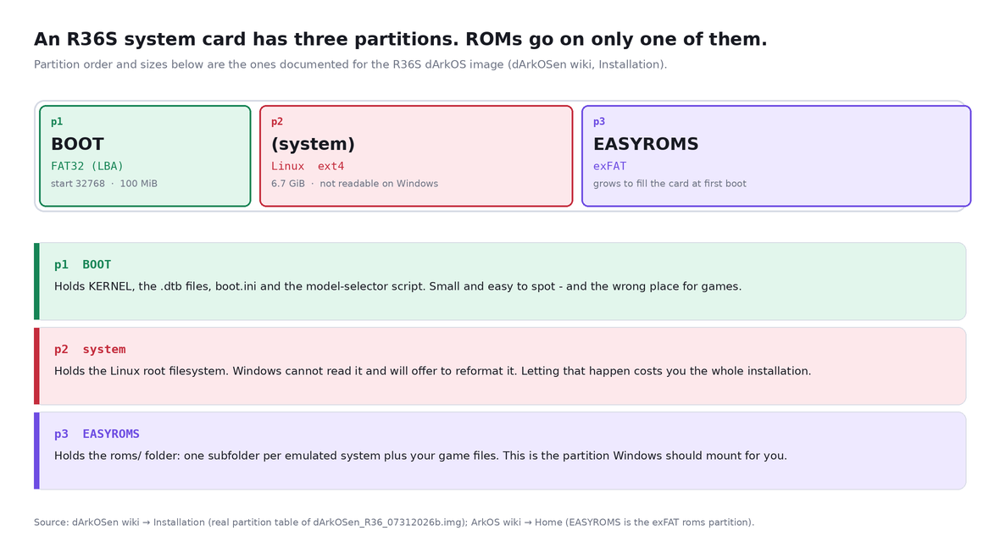
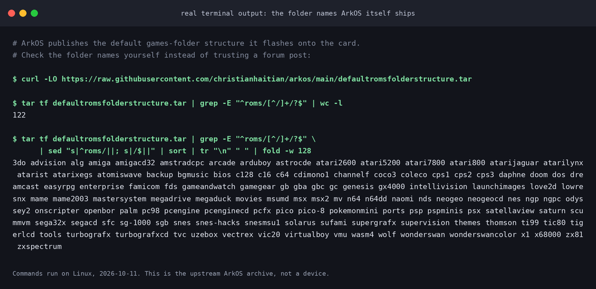
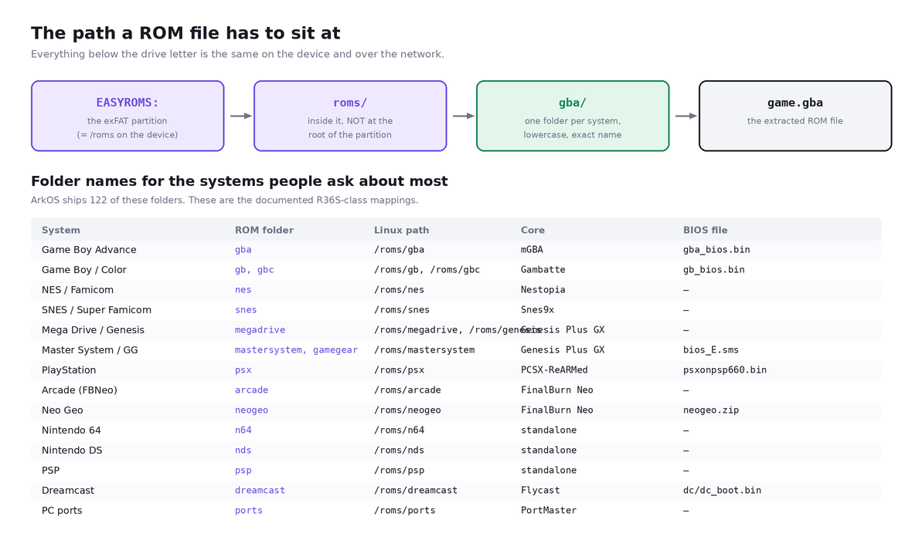
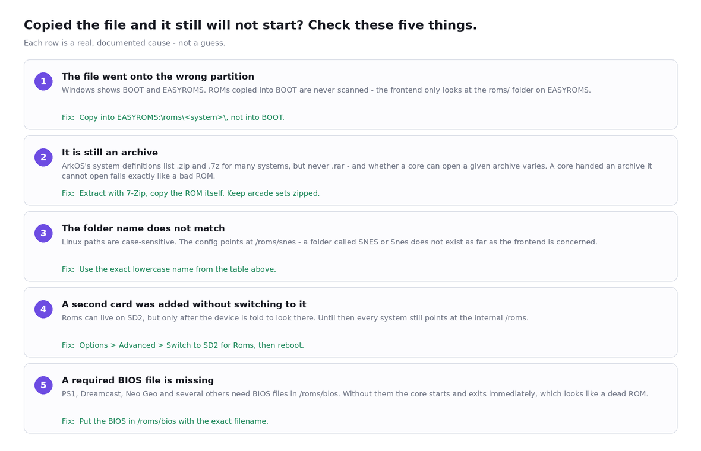
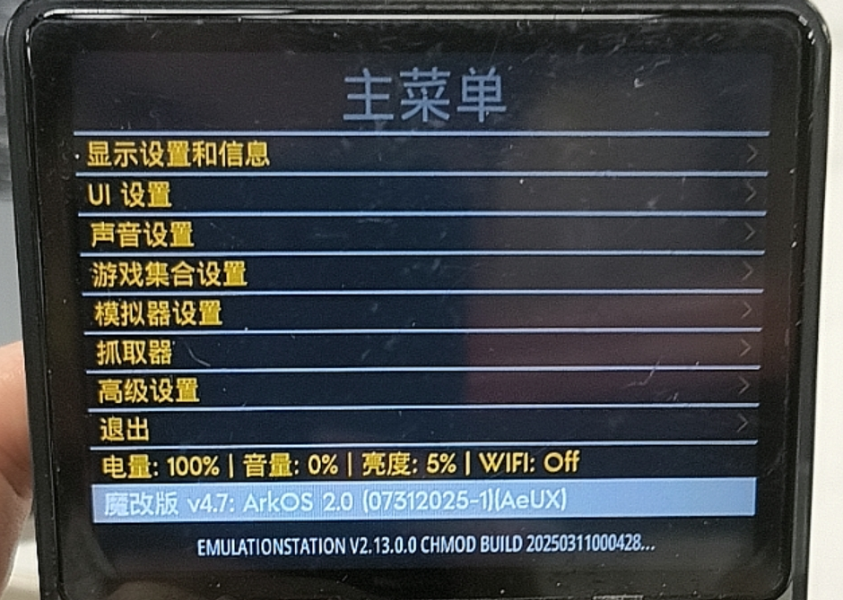

# R36S: the ROMs are on the card, but the games don't show up or won't launch

**English** · **[中文](README.zh-CN.md)**

> **Short answer.** On an ArkOS / dArkOS R36S card the games do **not** live on the small
> FAT32 partition Windows offers you, and they do **not** live at the root of the card.
> They live in `roms/<system>/` on the large exFAT partition whose volume label is
> `EASYROMS` — and `<system>` must be the exact lowercase folder name the frontend is
> configured to look at (`gba`, `nes`, `snes`, `psx`, `megadrive`, …). Get either of those
> two things wrong and the frontend behaves as if the file were never copied: a system with
> zero recognised games is hidden from the menu entirely, so there is nothing to open and
> nothing to report.

This page is the long version of that answer: the real partition layout, the real folder
names, the five things that actually stop a correctly-copied ROM from launching, and how to
verify each one. Every command below was run while writing this; the raw captures are quoted
in the screenshots.

---

## 1. What people actually report

These are verbatim messages from Chinese handheld QQ groups. Only the group name is given —
the archive they were extracted from does not reliably identify individual senders.

> `[开源掌机中文社区⑤群]` 问个小问题，为什么我下载的一些hack游戏rom，放掌机里没法玩呢，换光了核心也不行

*"Quick question: why do some of the hacked ROMs I downloaded not work when I put them on the
handheld? I've tried every core and it still doesn't work."*

> `[r36s（开源掌机）交流1群]` 意思是叫他来这里下载游戏放到掌机中玩，我也是刚到手，只知道有这个，但还不懂怎样把游戏放到掌机中

*"So the idea is you download games and put them on the handheld. I just got mine, I know
this exists, but I still don't understand how to get games onto the handheld."*

> `[安伯尼克掌机交流群]` @土豆 有没有视频教程解压后怎么放到内存卡根目录。

*"Is there a video showing, after extracting, how to put things at the root of the memory card?"*

> `[R36S掌机爱好者]` 我发现掌机只能识别fat32文件系统

*"I've found the handheld can only read the FAT32 filesystem."*

> `[r36s（开源掌机）交流1群]` 如果下了一个64g的游戏包后面还能一个一个往里面添加自己喜欢的游戏吗

*"If I download a 64 GB game pack, can I still add games I like one at a time afterwards?"*

> `[r36s（开源掌机）交流1群]` @旋转企鹅Z   资源群公告和群文件里全都有。懒得自己翻看就别张口发问，无脑伸手直接踢。这里歧视弱智

*"The resources are all in the group announcement and the group files. If you can't be bothered
to look, don't open your mouth. Mindless begging gets you kicked."*

Two conclusions from the log itself: this is the single most-repeated question in the
handheld groups, and the groups' own answer is **"here is the path"**, not "here is a link".
That is what this page does.

**One warning about the advice already circulating.** The groups cover dozens of devices, and
some of the most-quoted "answers" are for **Android** handhelds, not for the R36S:

> `[安伯尼克掌机交流群]` 电脑下整合包，注意分卷用 WinRAR/7-Zip 解 part01 ，别多层嵌套。解出来应是 ROMs/gba 、 ROMs/gb …
> 掌机连电脑选"文件传输"，电脑会出 KPA 设备盘。… 装模拟器 APK 并首次全开给权限：RetroArch… PPSSPP（PSP）DraStic（NDS）

The R36S is not Android. There is no KPA drive, no APK to install, and no per-app permission
screen. Every emulator on it is already installed by the system image. Copy-pasting the Android
recipe onto an R36S is one of the ways people end up with an empty-looking card.

> ⚠️ **Not tested:** we have no Android handheld and no KPA device, so we make no claim about
> whether that procedure works there. We only claim it does not describe the R36S.

---

## 2. Why this happens

### 2.1 The card has three partitions, and only one of them is scanned



The partition table below is the one documented for the R36S dArkOS image — an MBR table with
three partitions, reproduced here with `fdisk` on a test file so you can see the exact type
codes:

| Partition | Start sector | Size in the image | Type code | What it holds |
|---|---|---|---|---|
| p1 | 32768 | 100 MiB | `0c` W95 FAT32 (LBA) | `KERNEL`, the `.dtb` files, `boot.ini`, the model selector |
| p2 | 237568 | 6.7 GiB | `83` Linux (ext4) | the Linux root filesystem |
| p3 | 14368768 | 100 MiB placeholder | `07` HPFS/NTFS/exFAT | **becomes `EASYROMS`** — grown to fill the card and converted to exFAT on first boot |

So the two partitions Windows can actually read are the small `BOOT` one and the big
`EASYROMS` one. `BOOT` is the one that appears instantly and looks like "the card"; it is also
the one that must never hold your games, because the frontend only scans `EASYROMS/roms`.
Copying a ROM into `BOOT` produces a card that is visibly full and a handheld that shows
nothing new.

`p2` is ext4. Windows cannot read ext4 at all — which is why Windows occasionally offers to
reformat a perfectly healthy card. See the companion page
[`r36s-sd-card-readonly-recovery`](https://github.com/metahubaifeel/r36s-sd-card-readonly-recovery)
for that dialogue and what to do about it.

> ⚠️ **Not tested on our own hardware:** we did not dump the partition table of a
> supplier-flashed retail card. The layout above is the one the R36S dArkOS project documents
> for its image. A stock card flashed by a different supplier may differ in sizes; the
> *structure* — small FAT32 boot partition, Linux partition, large exFAT games partition — is
> what matters.

### 2.2 The folder name *is* the interface

ArkOS ships the folder structure on the card itself, and you can read the authoritative list
straight out of the project's own repository rather than trusting a forum post:



122 top-level folders. The names that matter most, with the core and BIOS file the R36S-class
builds map them to:



| System | Folder(s) | Linux path | Core | BIOS file |
|---|---|---|---|---|
| Game Boy Advance | `gba` | `/roms/gba` | mGBA | `gba_bios.bin` |
| Game Boy / Color | `gb`, `gbc` | `/roms/gb`, `/roms/gbc` | Gambatte | `gb_bios.bin` |
| NES / Famicom | `nes` | `/roms/nes` | Nestopia | — |
| SNES / Super Famicom | `snes` | `/roms/snes` | Snes9x | — |
| Mega Drive / Genesis | `megadrive`, `genesis` | `/roms/megadrive` | Genesis Plus GX | — |
| Master System / Game Gear | `mastersystem`, `gamegear` | `/roms/mastersystem` | Genesis Plus GX | `bios_E.sms` |
| PlayStation | `psx` | `/roms/psx` | PCSX-ReARMed | `psxonpsp660.bin` |
| Arcade | `arcade` | `/roms/arcade` | FinalBurn Neo | — |
| Neo Geo | `neogeo` | `/roms/neogeo` | FinalBurn Neo | `neogeo.zip` |
| Dreamcast | `dreamcast` | `/roms/dreamcast` | Flycast | `dc/dc_boot.bin` |
| Nintendo 64 | `n64` | `/roms/n64` | standalone | — |
| Nintendo DS | `nds` | `/roms/nds` | standalone | — |
| PSP | `psp` | `/roms/psp` | standalone | — |
| PC ports | `ports` | `/roms/ports` | PortMaster | — |

Two consequences of this being Linux rather than Windows:

- **Names are case-sensitive.** The configuration points at `/roms/snes`. A folder called
  `SNES` or `Snes` is a different path that does not exist.
- **There is no "search my card" mode.** Nothing is discovered by content; a file is a game
  only if it sits under the configured path *and* its extension is in that system's extension
  list.

### 2.3 A system with no recognised games disappears

This is the part that makes the problem so confusing, and it is worth reading the frontend's
own source rather than guessing at it. In the EmulationStation fork ArkOS ships:

```cpp
// es-app/src/SystemData.cpp
bool SystemData::isVisible()
{
    if ((getDisplayedGameCount() > 0 || ... ))
    {
        ... return std::find(hiddenSystems.cbegin(), hiddenSystems.cend(), getName()) == hiddenSystems.cend();
    }
    return false;                          // <-- no games => the system is not shown at all
}
```

And when the configured path is not a directory, the scan gives up immediately:

```cpp
void SystemData::populateFolder(FolderData* folder, ...)
{
    const std::string& folderPath = folder->getPath();
    if(!Utils::FileSystem::isDirectory(folderPath))
    {
        LOG(LogWarning) << "Error - folder with path \"" << folderPath << "\" is not a directory!";
        return;
    }
    ...
            if(!isGame && Utils::FileSystem::isDirectory(filePath))
            {
                ...
                populateFolder(newFolder, fileMap);   // <-- it DOES recurse into subfolders
            }
}
```

Read those two snippets together and the whole symptom set falls out:

1. Wrong folder name → the path does not exist → **zero games → the system is hidden**. Your
   GBA games are not "not loading"; the GBA entry is not in the menu.
2. Wrong extension → the file is not counted as a game → the same thing happens.
3. **One extra wrapper folder is normally harmless**, because the scan recurses. This is where
   the widely-repeated group advice (*"别再套一层 Room/ROMs/ROMs"*) is technically wrong, and
   it sends people hunting for a nesting problem they do not have. What genuinely hurts is
   *displacing the system folder itself*: if your extraction produced `ROMs/gba/...` and you
   copied the whole `ROMs` folder into the card's `roms` folder, you now have
   `roms/ROMs/gba/...` and `/roms/gba` is gone. Recurse or not, that path does not exist.
4. Dot-files are skipped (`if(!showHidden && fileInfo.hidden) continue;`). That is exactly why
   the ArkOS documentation warns that adding ROMs from a Mac can make them vanish — macOS
   writes `._game.gba` AppleDouble sidecar files alongside the real ones, and the frontend
   ignores anything whose name starts with a dot.

### 2.4 The five failure modes, in the order worth checking



| # | Cause | What you see | Fix |
|---|---|---|---|
| 1 | File copied to `BOOT` instead of `EASYROMS` | Card looks full, library unchanged | Copy to `EASYROMS:\roms\<system>\` |
| 2 | Still an archive (`.rar`, multi-part `.7z`, …) | Appears in the list, exits immediately, every core fails | Extract with 7-Zip first; keep arcade sets zipped |
| 3 | Folder name or case wrong (`GBA`, `Snes`) | The whole system is missing from the menu | Use the exact lowercase name |
| 4 | Second card fitted but not enabled | Everything still reads from the internal `/roms` | `Options > Advanced > Switch to SD2 for Roms`, reboot |
| 5 | Required BIOS file missing | PS1 / Dreamcast / Neo Geo start then die | Put the BIOS in `/roms/bios` with the exact filename |

On #2, precisely: ArkOS's shipped system definitions list `.zip` and `.7z` as valid extensions
for many systems, but `.rar` is not in any of them, and whether a given core can actually open
a given archive varies by core and by how the archive was packed. That is why "I tried every
core" goes nowhere — the failure is in the container, not the core. Note the deliberate
exception: **arcade sets for FinalBurn Neo / MAME are distributed as zips and must stay
zipped.**

> ⚠️ **Partially verified:** the extension lists above were read from the `es_systems.cfg`
> published in the ArkOS repository (the 2020 RG351-era file, 78 systems). We did not extract
> `es_systems.cfg` from an R36S card, so treat the exact per-system list as "this is how ArkOS
> builds its lists", not as "these are the bytes on your card".

### 2.5 What format the card should be — and what the groups get wrong

The log contains a claim worth correcting:

> `[R36S掌机爱好者]` 我发现掌机只能识别fat32文件系统 — *"the handheld can only read FAT32"*

The documented facts for this family of images are:

- The boot partition is **FAT32** (`0c` W1 FAT32 LBA). That part is true.
- The games partition, `EASYROMS`, is **exFAT** — ArkOS's own documentation says the image
  grows and converts the placeholder partition to exFAT on first boot, and that you should
  look for a drive letter literally named `EASYROMS`.
- A **second** card used for games may be `exFAT`, `EXT4`, `FAT`, `FAT32` **or** `NTFS`;
  ArkOS documents EXT4/exFAT/NTFS as the better choices, and warns that an EXT4 second card
  must have its contents owned by user/group `1002:1002` or some systems will fail to launch
  games.

So the machine is not FAT32-only. Where the belief comes from is usually that a card was
formatted with something the kernel does not mount at all, so the partition shows up on the
PC and never on the handheld.

> ⚠️ **Not tested:** we did not test every filesystem in the second slot on real hardware. The
> list above is quoted from ArkOS's own FAQ.

One real limitation is worth knowing before you pick FAT32 for a large card: **FAT32 cannot
hold a single file larger than 4 GiB.** PS1, Dreamcast, PSP and DVD-based images routinely
exceed that. exFAT does not have that limit. This is a property of the filesystem, not of the
R36S.

---

## 3. How to fix it

Do this in order. Stop as soon as the games appear.

**Step 0 — know which of your two cards is which.**
Power off completely. On the R36S the OS card and the game card sit in different slots; plug
the OS card into your PC with a reader.

**Step 1 — find the right partition.**
Open the card. You should get one small drive (`BOOT`, ~100 MB) and, on Windows 10 1703 or
newer, a second, much larger drive labelled `EASYROMS`. **Do not work inside `BOOT`.**
If `EASYROMS` has no drive letter, open Disk Management and assign one:

```
Win + X  →  Disk Management
right-click the partition labelled EASYROMS  →  Change Drive Letter and Paths…  →  Add  →  OK
```

This is the fix ArkOS and dArkOS both document for "my roms partition is invisible".

**Step 2 — copy to the right depth.**
Inside `EASYROMS` you should already see a `roms` folder. Open it and match the system:

```
EASYROMS:\roms\gba\      ← Game Boy Advance ROMs go here
EASYROMS:\roms\snes\     ← SNES ROMs go here
```

Do **not** create `EASYROMS:\roms\ROMs\gba`. Do **not** put files at `EASYROMS:\` directly.
Do **not** delete the folders that are already there — the NDS and PSP folders in particular
contain files the emulators need, even before you add a single game.

**Step 3 — extract before you copy.**
Downloaded packs arrive as `.rar`, `.7z` or split archives (`.part01.rar`, `.z01` + `.zip`).
Extract with 7-Zip starting from the *first* part, then copy the resulting ROM files. Put
required BIOS files into `EASYROMS:\roms\bios\` using exactly the documented filename
(`gba_bios.bin`, `psxonpsp660.bin`, `neogeo.zip`, …).

**Step 4 — if you are using a second card, enable it on the device.**
Eject safely, insert the card, boot, then:

```
START (the ES menu)  →  Options  →  Advanced  →  Switch to SD2 for Roms
```

Shut down, move your games onto the second card (exFAT recommended, label it something unique
such as `ROMS2` — **not** `EASYROMS`), and boot again. Two documented gotchas: once you are on
a two-card setup **both** cards must be present for the device to boot, and the second card is
where your BIOS files now belong.



*A real unit running an ArkOS-derived image. "Advanced Settings" (高级设置), the entry you need
in step 4, is on this menu — and the two version strings at the bottom are what you should quote
when you ask for help.*

**Step 5 — if Windows cannot see either partition, stop using the card reader on Windows.**
ArkOS documents two ways to add games that never touch a card reader:
`Options → Enable Remote Services` turns on SSH and Samba, so you can drop files straight into
`/roms/...` over the network, and the built-in FileBrowser ("ArkOS Browser") manages the roms
folder from a web browser.

---

## 4. How to check it worked

1. **Count the games from inside the system.** Boot the handheld and look at the system list.
   A system that is absent is a path/extension problem (`/roms/<name>` does not exist, or no
   file there matched the extension list). A system that is present but whose games exit
   immediately is an archive/BIOS/core problem.
2. **Check the partition labels, not the drive letters.** On Linux, with the card inserted:

   ```bash
   lsblk -o NAME,SIZE,FSTYPE,LABEL
   ```

   You should see something like a 100 MB `vfat` partition labelled `BOOT`, a `ext4` partition
   (no user label) and a large `exfat` partition labelled `EASYROMS`. If the big partition's
   label is not `EASYROMS`, you are not looking at a system card.
   On Windows, `Disk Management` shows the same thing in the "Volume label" column.
3. **Check the file you just copied is really where you think it is.** Sorting the folder by
   type and seeing a `.rar` sitting in `roms\psx\` is the fastest way to catch mistake #2.
4. **Check that a "missing" system is genuinely empty.** Put one known-good, unzipped, correctly
   named ROM into the folder, reboot, and see whether the system reappears. Because empty
   systems are hidden, one correct file brings the whole entry back.

---

## 5. How not to step on this again

- **Two cards, two jobs.** Keep the OS card untouched and put games on the second card. It
  makes the games card a plain data card you can format and rebuild without risking the
  system, and it makes whole-card backups far less painful.
- **One folder per system, never a folder per pack.** Extracted packs often arrive as
  `pack-name/gba/...`. Copy the *contents* of the pack's system folders into the card's
  matching folders, rather than copying the pack's root in.
- **Never let Windows "fix" a card it cannot read.** If Windows offers to format a partition on
  your R36S card, cancel. The partition it cannot read is the Linux one, and formatting it
  destroys the installation's system, not just some games.
- **Buy a real card from the start.** ArkOS's own instructions: minimum 8 GB, 16 GB or more
  strongly recommended, and do not use low-quality or no-name cards — they fail quickly and
  produce inconsistent emulation behaviour.
- **Keep arcade sets zipped, extract everything else.** And if you must use a Mac, clean up the
  `._*` sidecar files before ejecting.
- **Expect to reboot after adding games.** The library is scanned at startup; there is no
  reliable "refresh" that skips this.

### Where to get games

We do not link to ROM sites, and we are not going to pretend that "just download the 128 GB
pack" is a neutral recommendation: it is the single most common way people end up with a card
full of files that do not launch. The lawful short version is your own dumps of cartridges and
discs you own, homebrew and public-domain releases, and the many open-source ports that ship
through PortMaster directly on the device. The mechanics on this page apply either way.

---

## Sources

Everything factual above comes from one of these. Where we ran a command ourselves, the
capture is in the screenshots.

| Claim | Source |
|---|---|
| The 122 default `roms/` folder names | `defaultromsfolderstructure.tar` in [christianhaitian/arkos](https://github.com/christianhaitian/arkos) — verified by running `tar tf … ` on 2026-10-11 |
| Per-system folder name, path, core and BIOS file for R36S-class builds | [dArkOSRE-R36 wiki](https://github.com/southoz/dArkOSRE-R36/wiki) (per-system pages) |
| Real partition table and sizes of the R36S dArkOS image | [dArkOSen-R36S wiki → Installation](https://github.com/djparentx/dArkOSen-R36S/wiki/Installation) |
| `EASYROMS` is the exFAT roms partition; Windows may need a drive letter assigned; do not delete the shipped folders; SSH/Samba/FileBrowser for transfers; macOS `._` files break the listing; second-slot filesystem list and the `1002:1002` EXT4 warning | [ArkOS wiki → Home](https://github.com/christianhaitian/arkos/wiki/Home) and [ArkOS FAQ](https://github.com/christianhaitian/arkos/wiki/Frequently-Asked-Questions---RG353V) |
| Second card label advice and the `Options → Advanced → Switch to SD2 for Roms` path | [dArkOSRE-R36 wiki → Firmware Installation](https://github.com/southoz/dArkOSRE-R36/wiki/Firmware-Installation) |
| Recursive folder scan, empty systems hidden, hidden dot-files skipped, extension matching | [`SystemData.cpp` in EmulationStation-fcamod](https://github.com/christianhaitian/EmulationStation-fcamod) (ArkOS's frontend fork) — read on 2026-10-11 |
| `.zip`/`.7z` present, `.rar` absent in the shipped extension lists | `es_systems.cfg` in the ArkOS repository (2020 build, 78 systems) |
| The "you need to format the disk" prompt refers to the Linux partition; `TF1-OS` / `TF2-GAME` slot naming | [r36s.org → How to Add Games to R36S](https://r36s.org/articles/tutorial-add-games) (third-party guide) |
| Device runs an Ubuntu-based ArkOS, SSH user `ark/ark` after enabling remote services | [dov/r36s-programming](https://github.com/dov/r36s-programming) |
| QQ messages quoted in section 1 | internal analysis of 22,869 unique messages from 9 Chinese handheld QQ groups |

**Limits of the QQ data, stated plainly:** no reliable per-message timestamps, no reliable
attribution of a message to a named sender, two of the eleven handheld groups yielded a name
but no message bodies, and the sample is dominated by one large group. Counts quoted anywhere
in this repository are message counts, not frequencies over time.

## Related

- Companion page: [R36S SD card: "you need to format the disk" — recover instead of formatting](https://github.com/metahubaifeel/r36s-sd-card-readonly-recovery)
- r36s.space — [first steps and safe setup](https://r36s.space/guide)
- r36s.space — [R36S FAQ: charging, game files, board revisions](https://r36s.space/faq)
- r36s.space — [the bare R36S: boards and finishes](https://r36s.space/products/r36s)
- r36s.space — [before you buy a bare R36S: a checklist](https://r36s.space/blog/bare-r36s-checklist)

## Licence

MIT — see [LICENSE](LICENSE). The screenshots in `docs/` include photographs of our own
hardware; reuse them freely with attribution.
